<p align="center">
  
</p>

<h1 align="center">Frame Builder</h1>
<p align="center">Design, preview and export 3D-printable frames and UV-printable backing panels.</p>

<p align="center">
  <a href="https://github.com/TechSavage1989/Frame-Builder/releases/latest">Download</a> ·
  <a href="#getting-started">Get started</a> ·
  <a href="#features">Features</a> ·
  <a href="#screenshots">Screenshots</a> ·
  <a href="#development">Development</a>
</p>

<p align="center">
  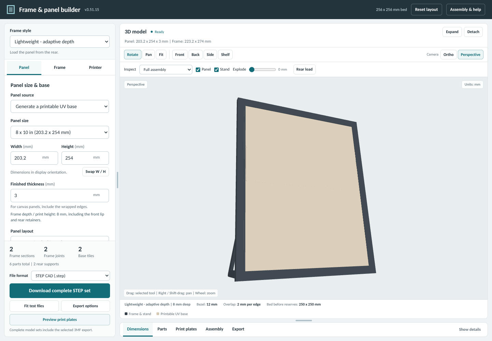
</p>

## Features

| Design | Inspect | Export |
| --- | --- | --- |
| Four frame styles, standard/custom panel sizes and printable UV bases | Live 3D preview, detachable viewer, exploded assembly and print plates | STL print files, STEP CAD and bed-arranged 3MF |

- **Four frame styles:** Original Snap, Top-Loading, Lightweight Adaptive Depth and Front Snap Borderless.
- **Build to fit:** reinforced UV-panel joints, optional Front Snap frame springs, one-/two-/four-section planning, centered braces, mounts and stands.
- **Plan the print:** fit-test parts, arranged plates and Bambu X1C bed exclusions.

## Screenshots

### Frame styles

<table>
<tr><td width="50%" valign="top"><b>Original snap frame, with the panel loading through the top opening</b><br></td><td width="50%" valign="top"><b>Top-loading frame, with its panel loading view</b><br>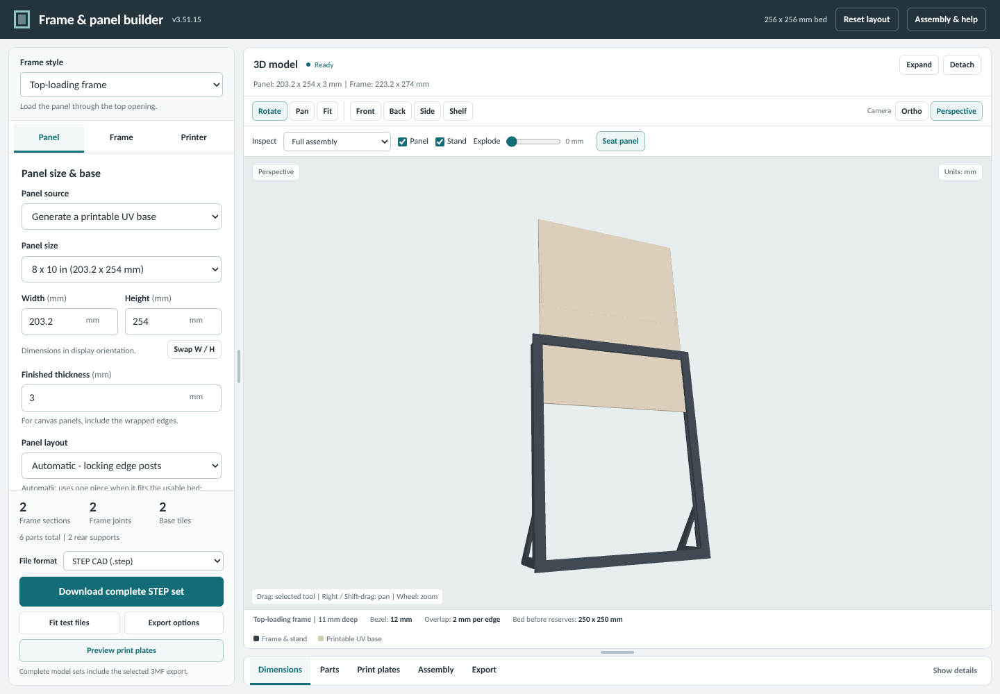</td></tr>
<tr><td width="50%" valign="top"><b>Front Snap Borderless frame with its assembly guidance</b><br>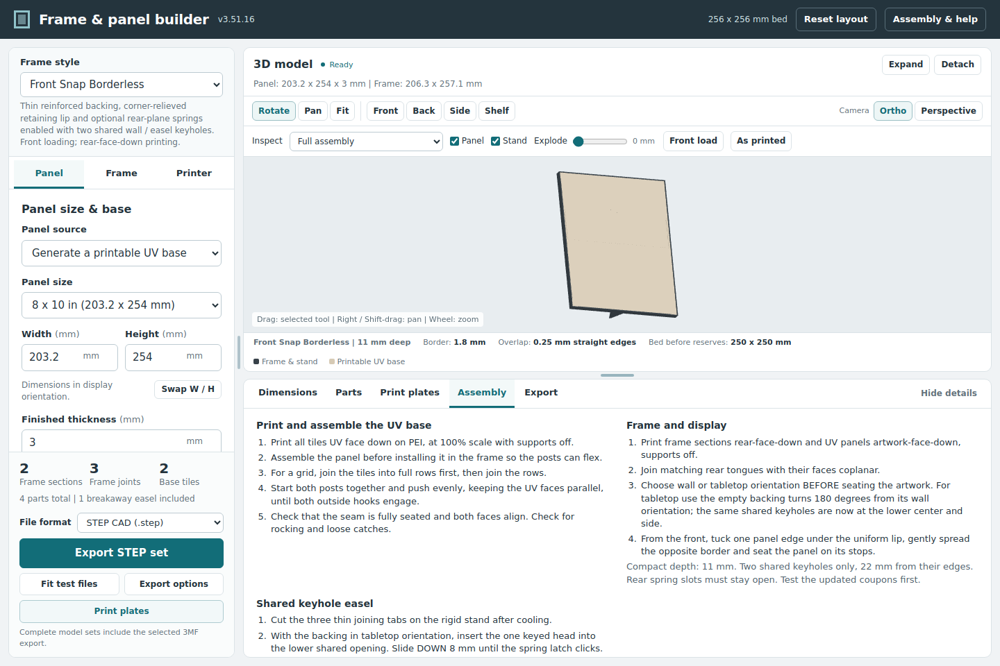</td><td width="50%"></td></tr>
</table>

### Design and inspect

<table>
<tr><td width="50%" valign="top"><b>Frame settings: bezel, artwork overlap, joint faceplates and orientation</b><br>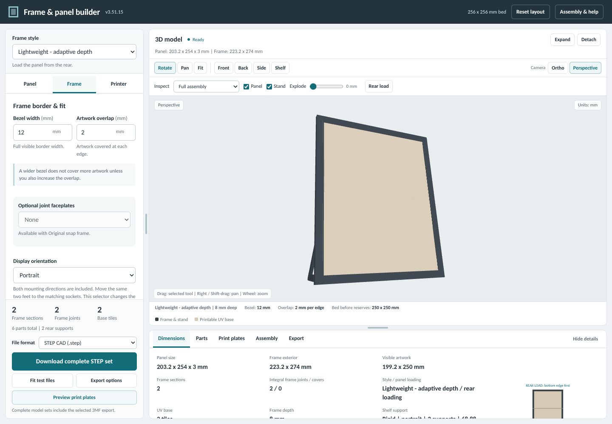</td><td width="50%" valign="top"><b>An 18 x 24 in panel planned into frame sections and UV base tiles, exploded</b><br>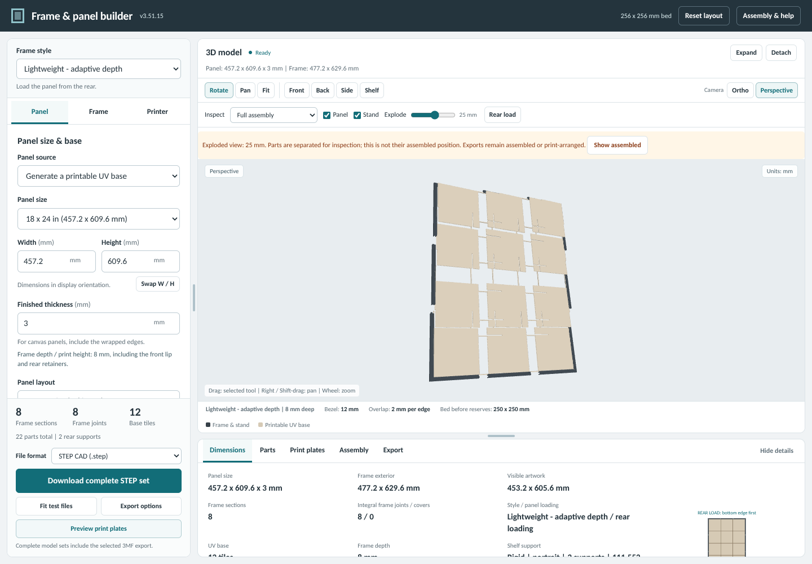</td></tr>
<tr><td width="50%" valign="top"><b>Exploded assembly with the parts list</b><br>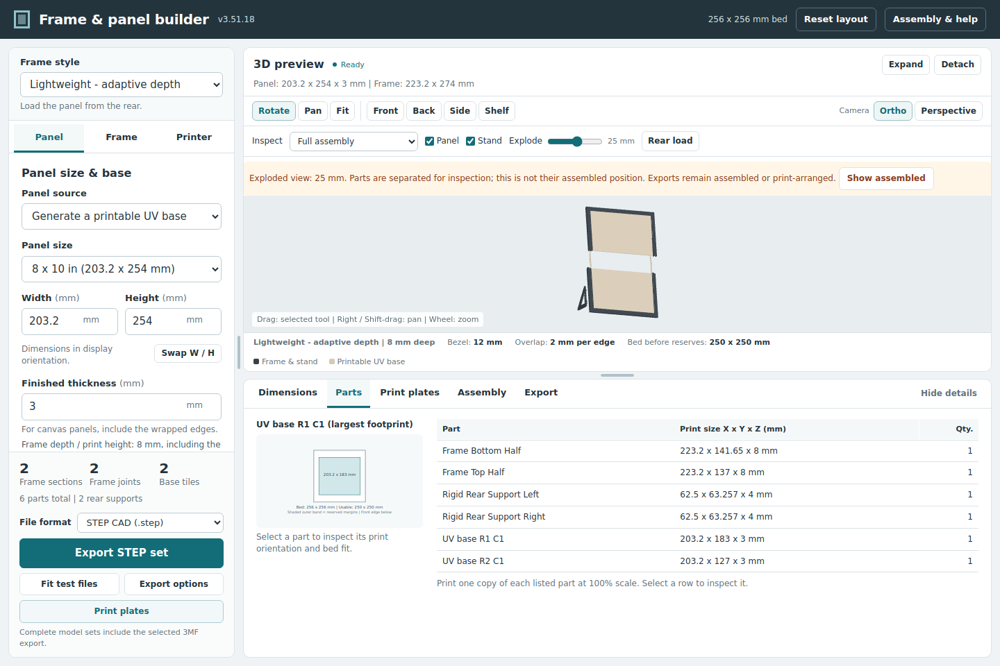</td><td width="50%" valign="top"><b>Inspect a single part, with its print size</b><br>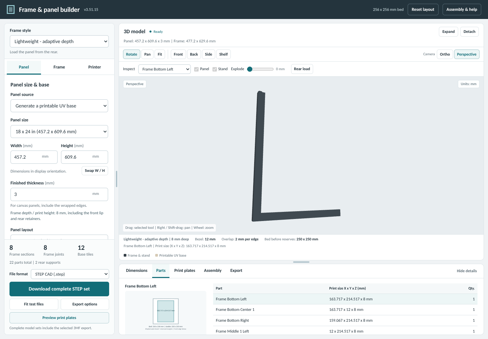</td></tr>
<tr><td width="50%" valign="top"><b>The live 3D viewer detached into its own window</b><br>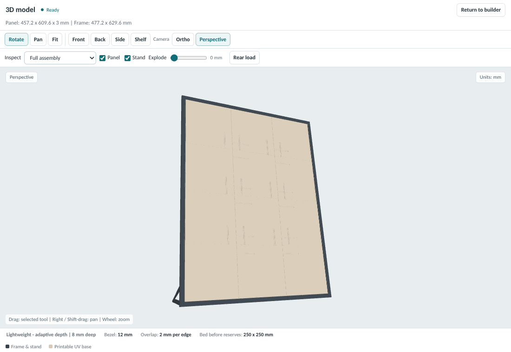</td><td width="50%"></td></tr>
</table>

### Plan the print and export

<table>
<tr><td width="50%" valign="top"><b>Printer settings: frame sections, bed size and margins</b><br>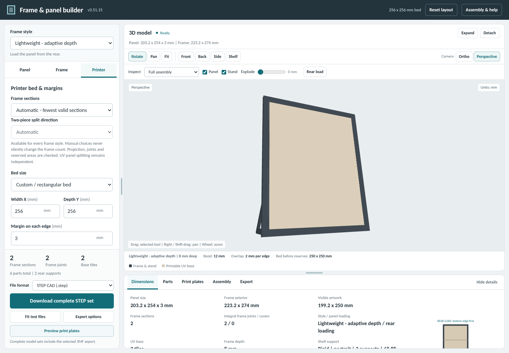</td><td width="50%" valign="top"><b>Print plate preview, arranged for the printer bed</b><br>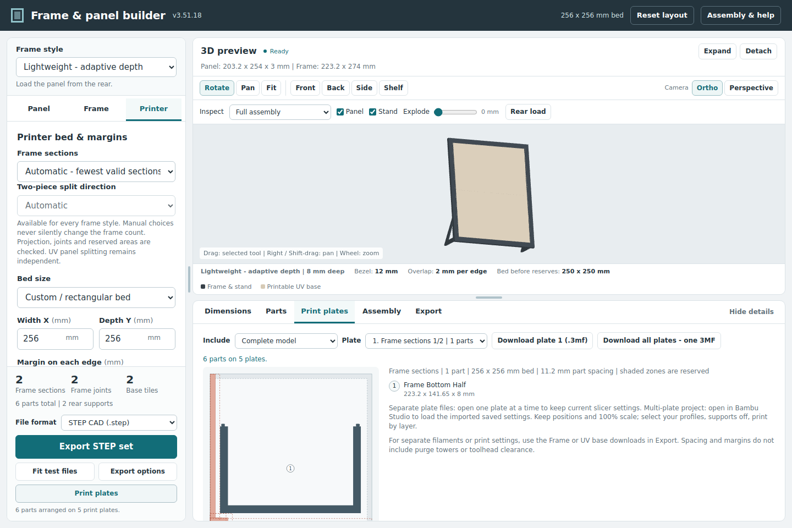</td></tr>
<tr><td width="50%" valign="top"><b>Export options: 3MF plates, STEP CAD assemblies, fit tests and STL sets</b><br>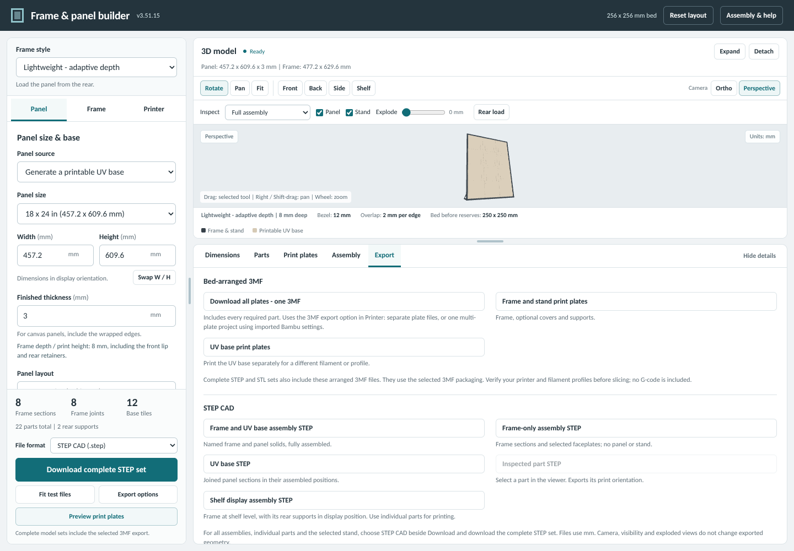</td><td width="50%"></td></tr>
</table>

## Download

**[Get Frame Builder for Windows →](https://github.com/TechSavage1989/Frame-Builder/releases/latest)**

In the release's **Assets**, choose `Frame_Builder_<version>_Windows_x64.zip`. This is the portable application; GitHub's **Source code** archives are for development. Release notes and `SHA256SUMS.txt` are on the same page.

## Requirements

- **Windows x64** for the portable desktop application.
- A writable local folder for the app and a slicer to prepare exported models.
- Internet access for downloading the app and checking for updates.

The application is **not code signed**. Release checksums verify integrity against the trusted repository, not publisher identity.

## Getting started

1. **Extract the ZIP** and run `Frame Builder.exe`. Keep this folder if you create a shortcut.
2. **Choose a frame style.** In **Panel**, set the size and finished thickness, then choose an existing panel or generate a printable UV base.
3. **Review Frame and Printer settings**, including section planning and your printer's bed limits.
4. **Inspect the preview** and choose **Preview print plates** to check the layout.
5. **Print a fit test first:** select a file format and use **Fit test files**. Once the fit is right, choose **Download print files** for the complete model.

> Check alignment, retention and release before printing a full model. Review **Assembly & help**, use 100% scale and the supplied orientations, and verify printer/filament profiles in your slicer. Exports do not contain G-code.

## How to use

- **Explore the model:** rotate, pan, zoom or inspect an individual part. Camera, visibility and exploded views do not change exported geometry.
- **Use a second window:** choose **Detach** for the live viewer. Keep the builder open; closing the detached window returns the viewer.
- **Choose an output:** STL for print geometry, STEP for CAD solids, or 3MF for arranged plates. Review the selected 3MF packaging before slicing.
- **Find assembly guidance:** use **Assembly & help** and the model's **Assembly** details.

## Updates and settings

Open **Help → Check for updates**. If a newer stable release is available, choose **Download**, save your work, then **Install and restart**.

Checks run at startup, every five minutes while online, and on a focus return after at least two minutes since the last check. **Downloads and restarts require your action.** Active model/export work blocks restart; failed/offline checks leave online status unknown.

- Coming from **3.51.6 or a preview through 3.51.12**? Install the portable ZIP manually first.
- Preferences and window bounds remain in `%APPDATA%\Canvas Frame Builder`.
- The updater preserves the exact EXE path, including custom filenames and shortcut targets, and keeps one rollback backup in per-user storage.

## Troubleshooting

- **Export or restart unavailable?** Wait for the model/export operation to finish and check any visible validation message.
- **Update check failed?** Check connectivity and retry when the app's cooldown permits. A failed check does not mean you are current.
- **Installation failed?** The updater checks the new window's health and attempts to restore the previous EXE. See the [handoff](DEVELOPMENT_HANDOFF.md) for logs and recovery storage.

Hosted Windows tests do not replace checking the app on your PC or physically testing printed parts.

## Development

<details>
<summary><strong>Build instructions, source layout and validation</strong></summary>

Read [AGENTS.md](AGENTS.md) and [DEVELOPMENT_HANDOFF.md](DEVELOPMENT_HANDOFF.md) before making changes or publishing.

Use **Node.js 22 on Windows**:

```sh
npm ci
npm run check
npm run build:windows
```

`Build_Windows.cmd` is the Windows shortcut; output goes to `dist`.

- `app/`: desktop shell, updater and generated desktop HTML.
- `cad_source/`: CAD/model source and regression checks.
- `browser/Canvas_Frame_v3_51_6_Builder_and_3D_Viewer.html`: standalone browser baseline, not the current desktop updater.

[Release 3.51.15 verification](https://github.com/TechSavage1989/Frame-Builder/actions/runs/40218552668) covers the actual 3.51.14 → 3.51.15 update, Windows installation/rollback, saved preferences and shortcut continuity. Exact source, hashes and remaining limits are recorded in the handoff. No new physical print/fit/load testing is claimed.

The desktop preserves the accepted Canvas Frame Builder 3.51.6 geometry. Fusion Builder is separate; rejected later Borderless fold-flat prototypes are excluded. macOS/Linux desktop packaging is not provided.

</details>

### Source organization

`app/`, `browser/` and `cad_source/` retain their existing source roles; assets/ holds branding; scripts/ holds build and test tooling; validation/ holds evidence. See [development handoff](DEVELOPMENT_HANDOFF.md) and [release notes](docs/releases/RELEASE_NOTES.md).

## License

Source and releases are public; **no reuse license has been selected**.
